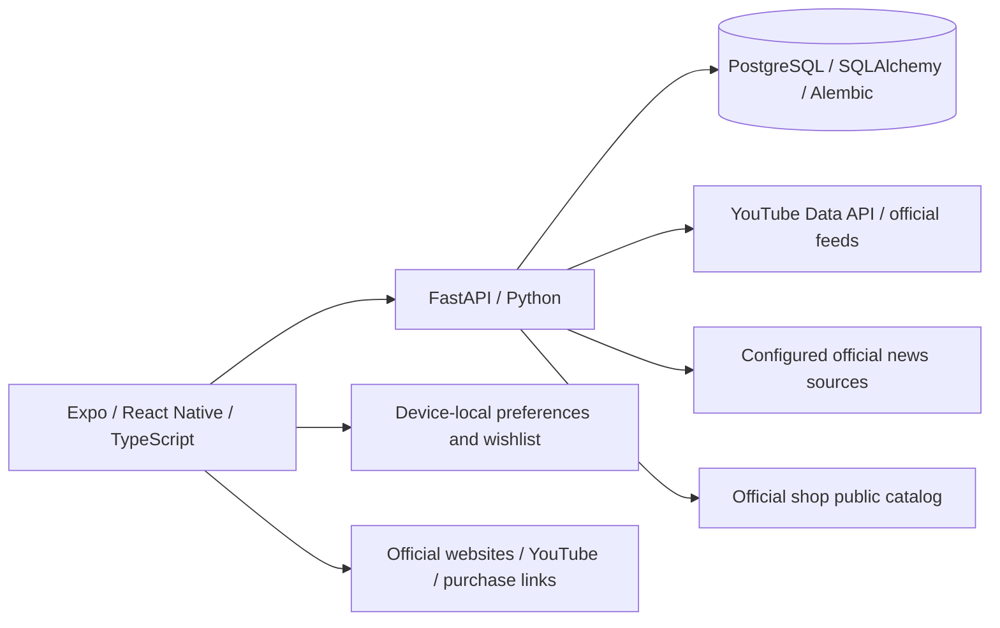

# Ado Fan Hub

> **Unofficial / Non-commercial Fan Project** · Early development

A free, independent fan-made companion for discovering Ado news, music videos, and official merchandise. This project is not affiliated with, endorsed by, or sponsored by Ado, her management, record label, or official stores. It is not an official app.

## Current functionality

The current development branch contains the following implementations. Availability depends on backend configuration, source availability, and platform; this is not a production readiness guarantee.

- **News:** aggregated news from configured official sources, with feed browsing and backend history/search services. Source links lead to the original publisher.
- **MV:** YouTube music-video and playlist discovery, catalog synchronization, rankings, and statistics views. Playback and source navigation use YouTube.
- **Shop:** official merchandise catalog browsing, campaign/availability information, and links to the official product pages. Prices and stock can change; the official store is authoritative.
- **Wishlist:** a device-local personal list selected from the official catalog, with quantities/options, currency conversion, and budget estimates. **It is independent of the official shopping cart and payment system.** Restock observation and notification code is present; delivery depends on platform permissions and backend setup.
- **Official links and preferences:** access to official channels, region, time zone, and interface language preferences (Japanese, Traditional Chinese, and English).
- **About Ado and YouTube statistics:** artist introduction, official source links, channel statistics, observed growth, and MV rankings. MV discovery and statistics use the official YouTube Data API; historical charts compare collected observations and public subscriber counts are approximate.

Purchases take place on the official store. This app does not operate a checkout, collect payment details, or sell official merchandise. Wishlist additions do not synchronize with an official shopping cart, reserve stock, create an order, or initiate payment. Budget totals are estimates, not a checkout quote; taxes, duties, fees, and actual payment exchange rates may differ.

## Architecture



The mobile app uses Expo Router. PostgreSQL supports news/MV persistence; auxiliary local stores and caches also exist for functions such as shop state and exchange rates. Do not assume every feature is stored in PostgreSQL.

### External services

- **YouTube:** backend API/feed integrations support metadata and catalog synchronization. API credentials belong on the server, never in committed files or public Expo variables. Quotas and source availability affect updates.
- **X API:** client, budget, and synchronization modules are under development. Paid live X API integration is **not enabled as an advertised app feature**. The sync pipeline instructs developers to use offline fixtures until billing and integration verification are complete; the explicit client can make requests if invoked with credentials. Do not treat the presence of client code as proof of a live service.
- **Official news and shop sources:** public accessibility does not establish permission to copy, cache, proxy, or redistribute content. Source terms and asset permissions must be checked before public release.

## Screenshots

Actual development screenshots supplied by the project owner, showing the Japanese interface and Android system navigation. Device model and exact capture dates were not separately confirmed. Values, availability, and dates are snapshots, not live data.

| Home | Explore | Official shop catalog |
| --- | --- | --- |
|  |  |  |

| Personal wishlist | Budget estimate | MV search |
| --- | --- | --- |
|  |  |  |

**Wishlist = personal planning only.** Users choose items from the official catalog to save locally and estimate a budget. Adding an item does not add it to the official shopping cart, place an order, or trigger payment. Purchases require a separate visit to the official store.

See the [complete screenshot tour](docs/SCREENSHOTS.md) for the five Home captures, official links, restock notifications, historical themes, About Ado, and YouTube statistics. The Settings capture shows language, country/region, time zone, and saving preferences. The captured selection is Japanese / Japan / Tokyo; supported interface languages are Japanese, Traditional Chinese, and English.


Screenshots are supplied app captures, not generated mockups. Third-party artwork, product photographs, avatars, and video thumbnails visible within them retain their respective ownership; the existing asset-rights review remains open.

## Official destinations

These are destinations configured in the app; users should verify the destination before signing in or purchasing.

- [Ado Official Shop](https://ado-officialshop-friedpotato.com/)
- [Ado on YouTube](https://www.youtube.com/@Ado1024)
- [Ado on X](https://x.com/ado1024imokenp)
- [UNIVERSAL MUSIC JAPAN — Ado](https://www.universal-music.co.jp/ado/biography/)
- [Cloud Nine — Ado](https://cloud9pro.co.jp/artist/profile/ado/)

## Development

Frontend:

```powershell
cd apps/mobile
npm ci
npx expo start
```

Backend: see [API setup](apps/api/README.md). Configure server-side environment variables locally. The database layer accepts `DATABASE_URL`, or reads a local ignored `.env.db.local` containing `POSTGRES_PASSWORD` for the development database. The Compose database binds to `127.0.0.1:5433`.

```powershell
# From the repository root; requires a locally configured .env.db.local.
docker compose --env-file .env.db.local up -d db
```

Apply reviewed Alembic migrations before using features that require database tables. Never paste real credentials into README examples, screenshots, issues, or logs. Do not enable paid integrations just to run the UI.

## Project structure

```text
apps/mobile/  Expo / React Native application
apps/api/     FastAPI services, source integrations, database models and migrations
docs/         Development notes and reviewed documentation
compose.yaml  Local PostgreSQL development service
```

## Rights and licensing

The project is intended for non-commercial fan use. That intent and this disclaimer do not grant permission to use third-party works.

Ado's name, likeness, logos, merchandise photographs, promotional artwork, music, video thumbnails, and other third-party content belong to their respective rights holders. Links and source attribution do not transfer ownership or establish a redistribution license. This repository does not grant a license to those materials. Unverified third-party assets must be cleared, replaced, or excluded before publication, including copies remaining in Git history.

No project-wide software license has been selected. The existing `apps/mobile/LICENSE` contains an Expo/650 Industries MIT notice; it must not be interpreted as licensing all original project code or all bundled artwork. Preserve applicable upstream notices and review dependency licenses separately.

For content or rights concerns, please contact the repository owner through their GitHub profile; avoid posting personal information in a public issue.

## Public-release status

This repository has been made public by its owner. Local Gitleaks scans found no secrets in the scanned Git history; 12 working-directory findings were all in Git-ignored files. These results do not guarantee that every remote reference or GitHub artifact has been audited. The review of third-party images, artist-related artwork, merchandise photographs, thumbnails, and applicable content permissions is still ongoing. Public availability does not imply endorsement, affiliation, or authorization by Ado or any rights holder.
