# Ado Fan Hub - Application Screenshot Tour

This document presents 22 real development screenshots of Ado Fan Hub, an independent, unofficial, non-commercial fan application. The captures show the Japanese-language Android interface. Device model and exact capture dates have not been independently verified.

Displayed dates, prices, availability, rankings, and statistics reflect the state at the time of capture, not necessarily current live information.

**Wishlist notice:** The wishlist is a local planning and budgeting tool. It does not synchronize with the official shopping cart, reserve inventory, create orders, or process payments. Purchases must be completed separately through the official store.

**Integration status:** Music-video discovery and YouTube statistics use YouTube Data API integrations and collected public observations. Live X API synchronization is not enabled as a production feature.

**Rights notice:** Third-party artwork, logos, merchandise photos, artist likenesses, and video thumbnails appearing in these screenshots remain owned by their respective rights holders. Permission to reproduce or redistribute these materials is not established. This project is not affiliated with or endorsed by Ado, her management, record label, or official stores.

## Home Overview

Home screen displaying recent news, YouTube information, and main navigation.

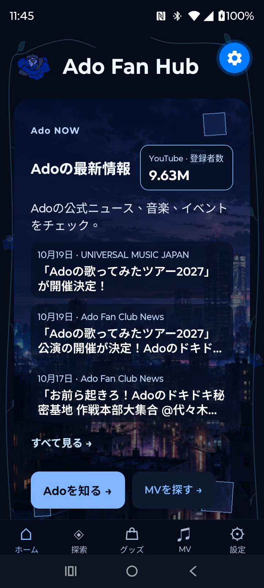

## Home Shortcuts

Quick access to news, music videos, analytics, and official links.

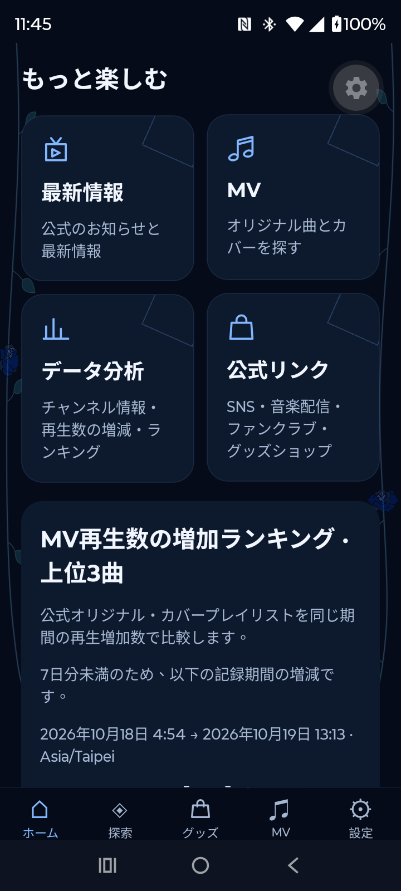

## MV Growth

Music-video view growth rankings based on collected observations.

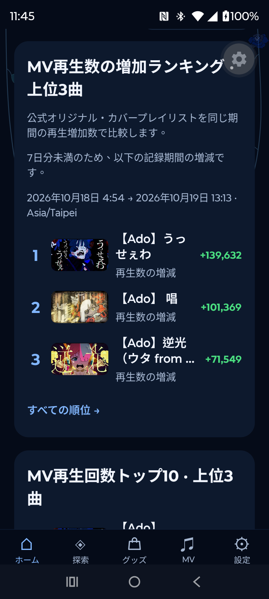

## MV Rankings

Music-video rankings and artist information navigation.

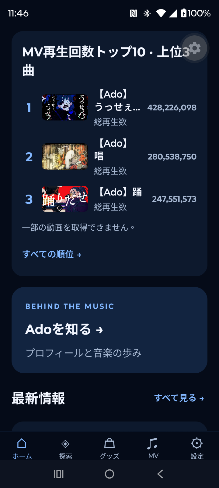

## Latest News

Recent news from configured sources, linking to original publications.

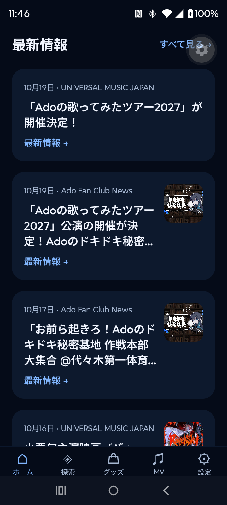

## Explore

Entry points for artist information, news, statistics, and music videos.

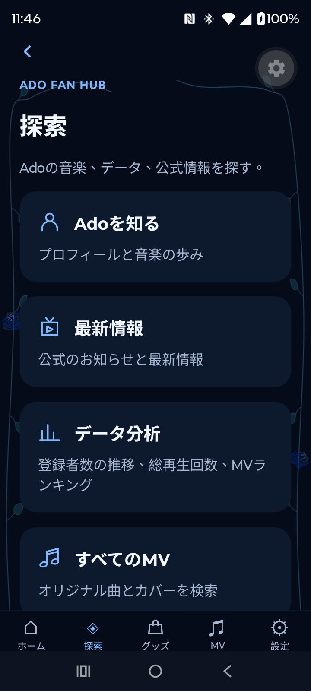

## Official Links

Links to official sites and channels. An X link does not indicate that live X API synchronization is active.

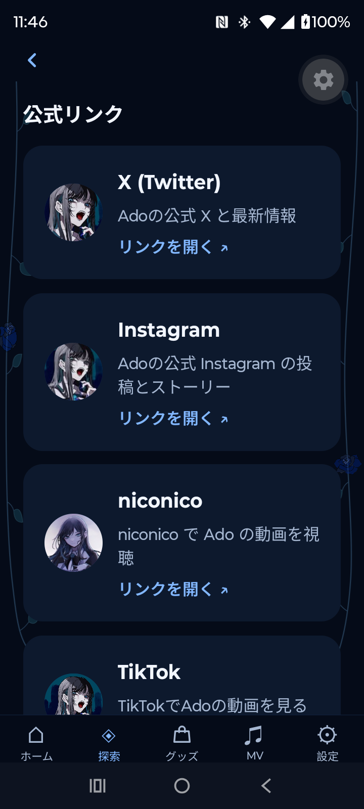

## Merchandise Catalog

Merchandise listings and access to a personal wishlist. Purchases take place separately on the official store.

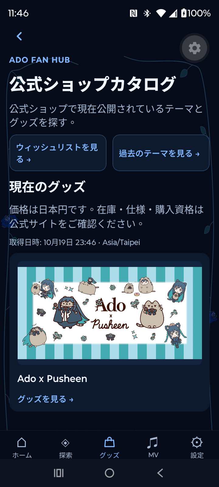

## Merchandise Availability

Development interface for availability and restock-related information, subject to source data and configuration.

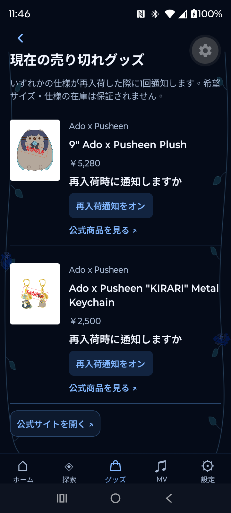

## Merchandise Collections

Browsing previously listed collections and merchandise themes.

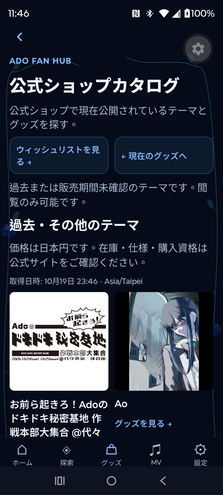

## About Ado

Artist introduction and links to related information.

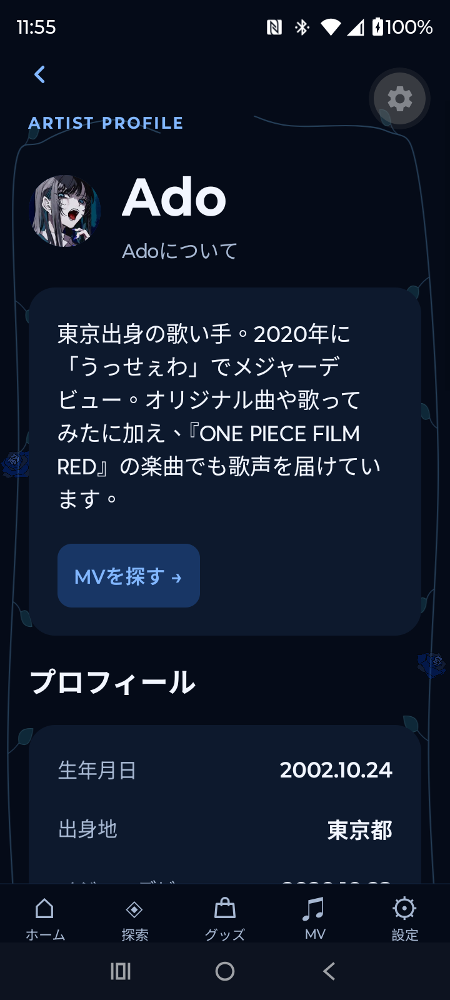

## Artist Timeline

Timeline-style presentation of artist-related information.

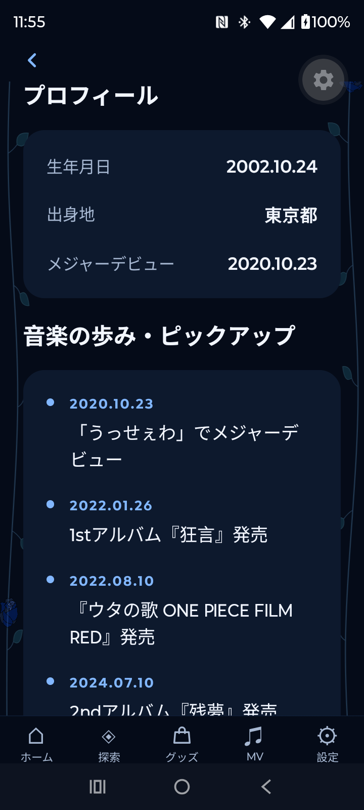

## Information Sources

External sources associated with the artist information section.

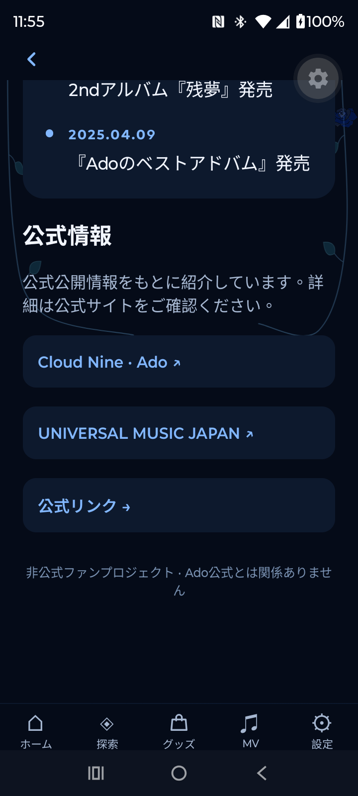

## YouTube Analytics Overview

Overview of publicly available YouTube channel and music-video statistics.

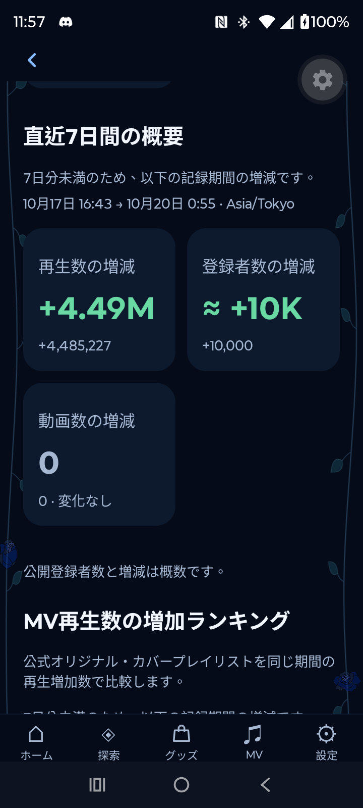

## Growth Analytics

Growth comparisons based on collected YouTube observations.

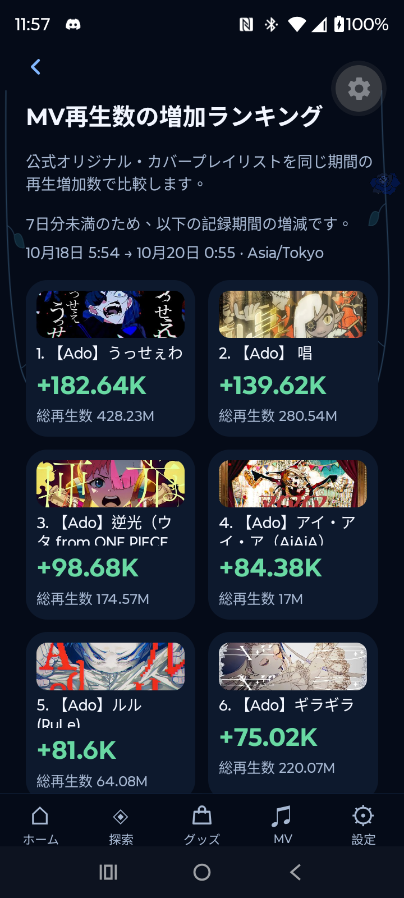

## Historical Statistics

Historical observations displayed for comparison over time.

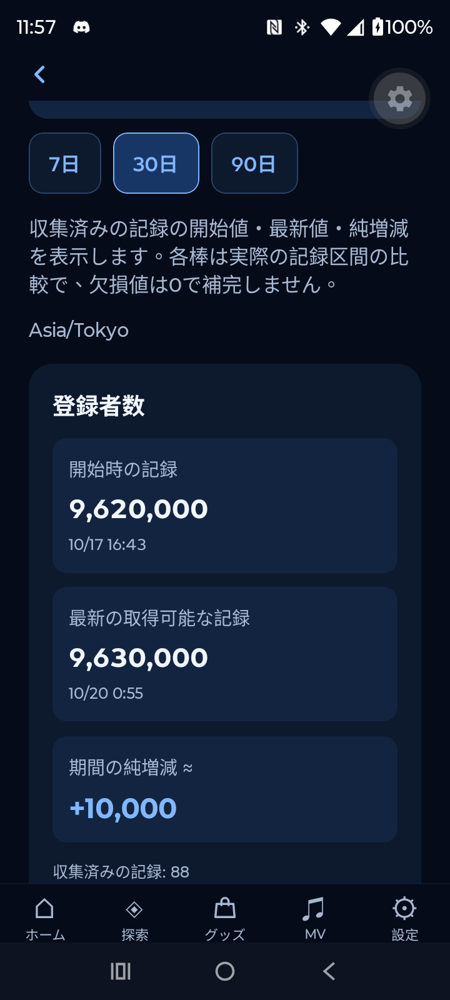

## Analytics Charts

Charts illustrating collected YouTube statistics.

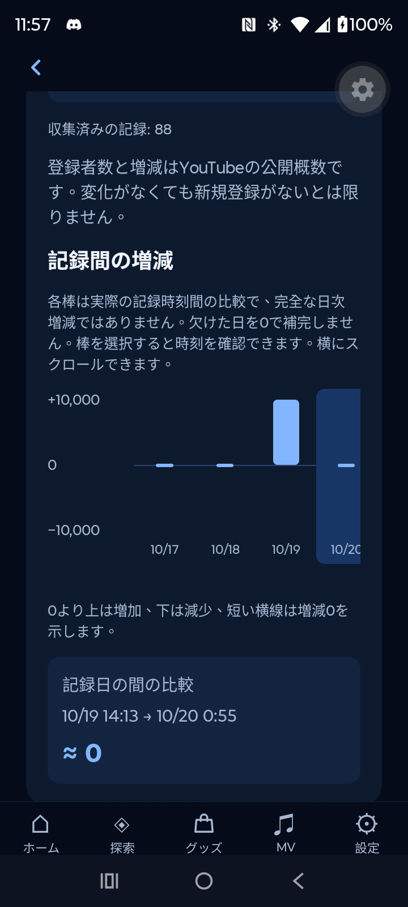

## Analytics Rankings

Rankings derived from publicly available YouTube metrics.

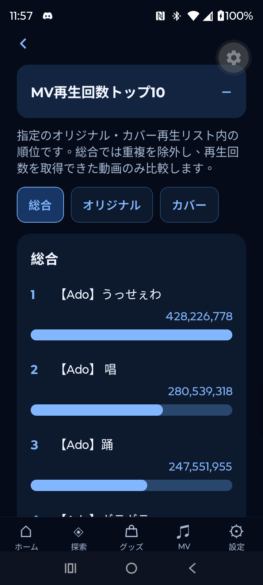

## Wishlist Budget

Estimated wishlist budget with currency conversion. Figures are not official checkout quotes.

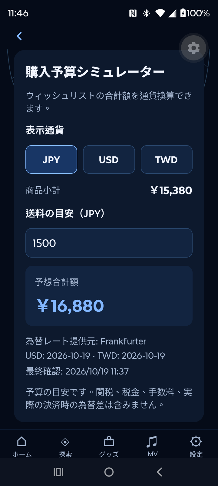

## Music Video Search

Search, filtering, and discovery of music videos and related YouTube content.

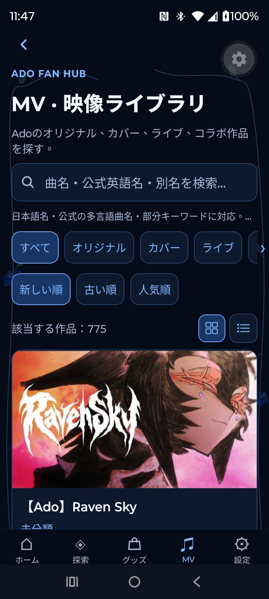

## Personal Wishlist

Locally saved merchandise selections, quantities, and cost estimates. No official order or payment is created.

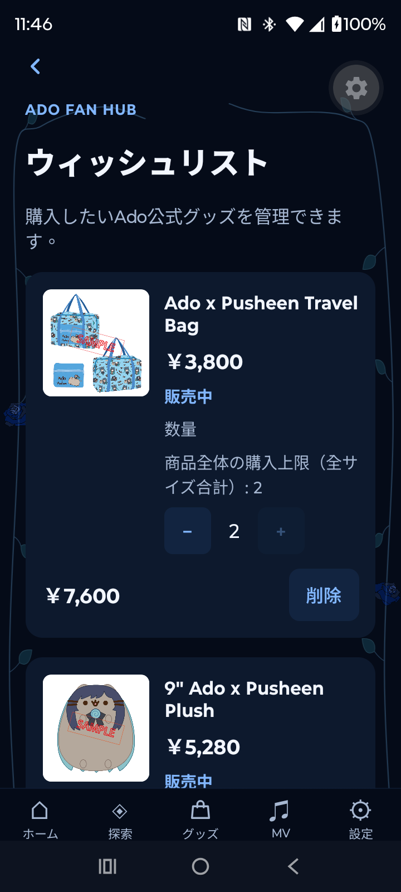

## Settings

Language, region, time zone, and preference controls. The capture shows Japanese, Japan, and Tokyo.

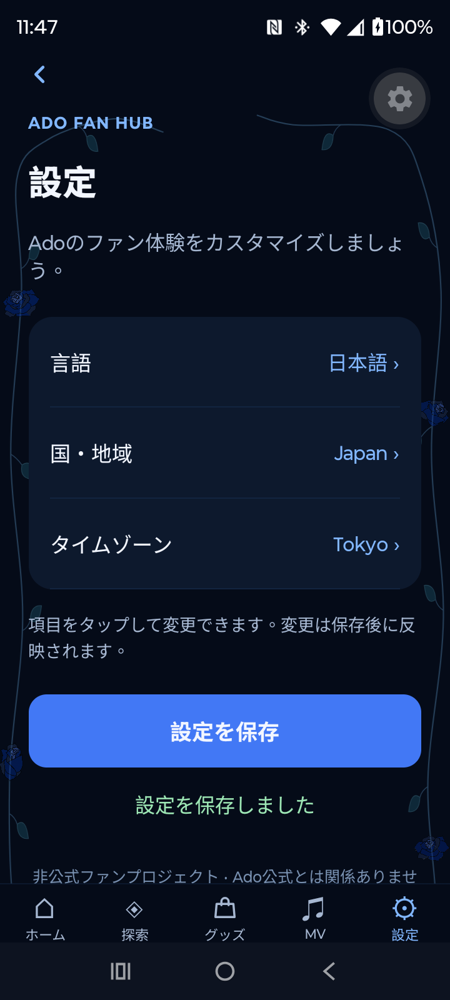

## Screenshot Notes

- Original screenshot images have not been edited as part of this documentation update.
- Prices, availability, exchange rates, shipping estimates, and video statistics may change.
- The official store is authoritative for product information and purchase conditions.
- Inclusion of third-party material does not imply permission or official endorsement.
